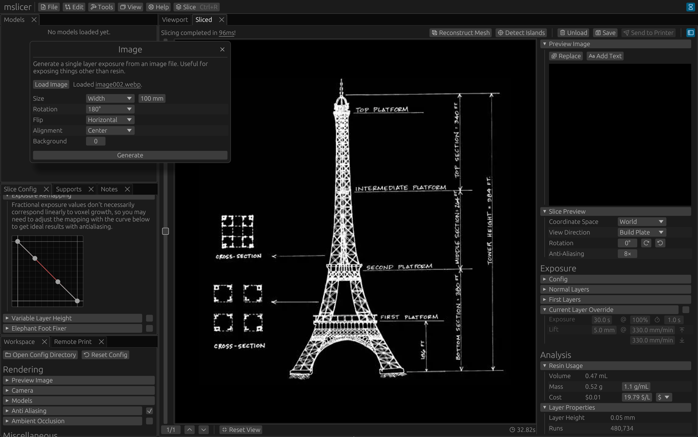
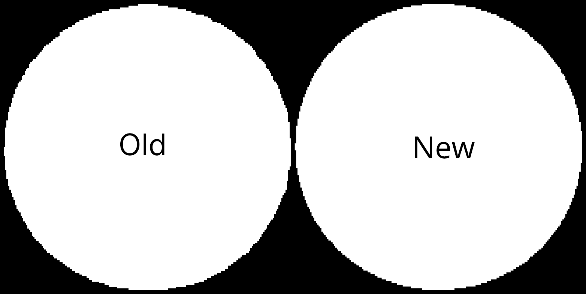
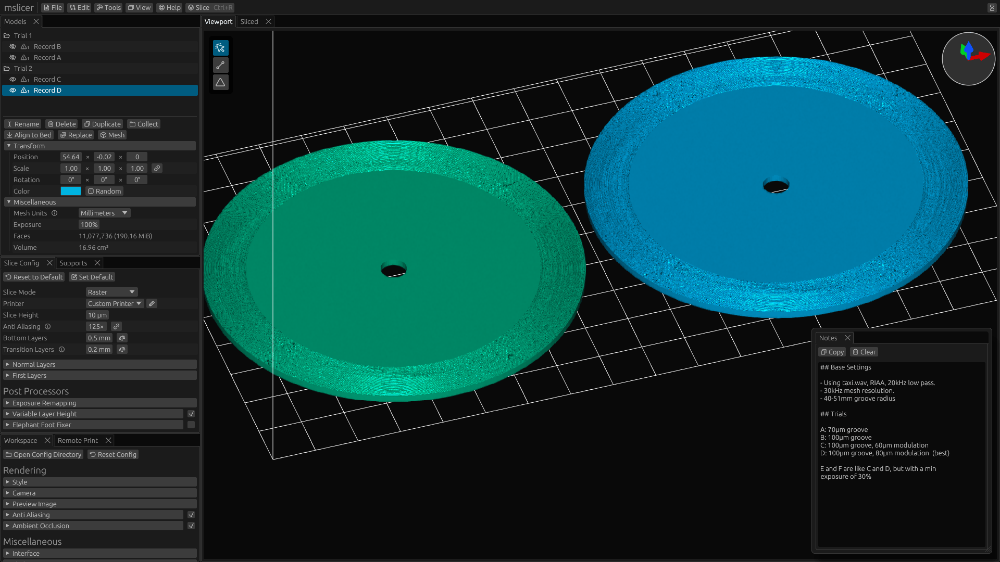

{{phosphor_icons()}}

This is a big release, about two months in the making!
The release notes only cover the biggest and most interesting new features. Check the [changelog](/docs/changelog) for a full list, including bug fixes.

## Modes

The 3D viewport now has three modes that change what clicking and hovering do: Cursor (default), Support, and Orient.
Additionally, there is a fourth button ({{icon(class="info")}})) that lets you toggle the hover overlay and select how much information to show (regular vs detailed).

- {{icon(class="cursor-click")}} **Cursor** &mdash; Selects a model in the `Models` panel, particularly useful with keyboard shortcuts like Delete (D), Duplicate (C), Hide (H), etc.
- {{icon(class="line-segment")}} **Support** &mdash; Used with the `Supports` panel for manually adding or selecting supports.
- {{icon(class="triangle")}} **Orient** &mdash; The model will be transformed so that the face you click is made parallel to the build plate (facing down).
  This makes orienting models much easier, removing the need to manually edit the rotation angles.

The modes can be switched by clicking the buttons or with the keyboard shortcuts 1 for Cursor, 2 for Support, and 3 for Orient.
Note that you can also hold Shift while drag-clicking to select multiple models or supports (depending on the mode) in some area on the screen.

## Sliced Panel

### Interactive Preview

You can now customize the generated preview image that gets embedded in the sliced file.
The 'Workspace › Preview Image' dropdown lets you configure the preview image size, background color, and camera properties.
Additionally, the preview image display has been replaced with a 3D view, allowing you to reposition the camera just by clicking and dragging!

It's not the most important feature, but I find it really cool.
Although maybe not worth all the work updating the render pipeline to support this...

<video src="https://files.connorslade.com/Documents/mslicer/Video/interactive-preview.webm" controls loop muted autoplay></video>

### Analysis

A few new sections were added to the analysis section of the sidebar: Resin Usage, Layer Properties, File Properties, and Defects.

- **Resin Usage** &mdash; Shows the estimated resin volume that will be used when printed.
  This is a conservative estimate, since it doesn't consider the uncured resin that gets wasted during cleaning / post-processing.
  The mass and cost are calculated from the estimated volume and the provided constants: resin density and unit cost.
- **Layer Properties** &mdash; Shows the height (Z-position), run count, and memory usage of the currently previewed layer.
- **File Properties** &mdash; Shows the default slice height (ignoring layers with variable layer height) as well as the size and resolution of the printer it was sliced for.
- **Defects** &mdash; Defective meshes can cause slicing defects, but won't always.
  If you have sliced a defective mesh and it results in slice defects, you can see which layers were affected here.

## Presets and Compatibility

The default list of printer presets has been significantly expanded, from 19 in the previous release to 100!
Most of these presets were scraped from my ChituBox installation if they were marked as supporting `.goo` or `.ctb` files.

Additionally, printers that are verified to work with mslicer are marked in the UI (see the {{icon(class="check-circle")}}) in the screenshot on the right) and on the new [Printer Compatibility](/docs/printer-compatibility) page.
The compatibility page also mentions if specific printers need to be handled differently, like using the new 'Legacy Chitu' output format.

### Chitu Legacy Format

This is a newly implemented output format!
It's called 'Chitu Legacy' in the UI, but more technically, it is an unencrypted v4 CTB file.
Useful if you, for example, have a Mars 2 Pro (or compatible) printer which can't read the newer encrypted v5 CTB file format.

## Generators

### Mesh

Meshes can now be generated for phonograph records (see [3D Printing Phonograph Records](/docs/phonograph-record)) and from a height map image.
Since these meshes can also be useful outside of mslicer, a new export option has been added to the model panel, supporting saving as `.stl` or `.obj`.

The 'Reconstruct Mesh' button in the sliced panel has also been updated with a new reconstruction mode: Greedy Meshing.
It just converts the binary voxel data directly into a mesh (with optional subsampling), much faster than marching cubes.

The model on the right was reconstructed from the sliced Utah Teapot, with a lot of downsampling (for artistic effect).

### Image Layer

UV light can expose more than just resin, for example, masks for chemical etching or UV-based photographic substrates.
The new 'Image Layer' tool lets you create print jobs with a single layer from any raster image file.

The image below shows a generated job that could be used to expose a cyanotype. (Although I have not yet tested how well this actually works.)

### Sliced Diff

This tool lets you visually compare the pixel differences between layers of two sliced files, similar to the `diff` tool.
Although mainly intended for testing and debugging of mslicer itself, it could (for example) be used to compare the layer outputs of different slicers, different settings, or different-resolution input models.

Using this tool, I was able to measure the effective error volume between different mesh triangulation resolutions, compared to the boundary representation (BREP) version.

Quick aside on slicing BREP: I thought it would be really cool to support naively slicing analytic geometry, but it turns out that it's faster to triangulate to hundreds of thousands of triangles and slice that than to use OpenCASCADE for BREP intersection testing.
Oh well... Maybe with a lot of custom code it could be made practical, but doesn't seem worth the effort right now for 'maybe'.

### Test Pattern

The Test Pattern tool lets you generate solid black, white, or checkerboard layers.
Again, mainly for testing, but could be useful for something!

The checkerboard pattern is kinda interesting because it's the worst possible case for run-length encoding, resulting in worse memory efficiency than a plain raster image.
For a printer with a screen resolution of 11520×5120, a single layer uses over a gigabyte of memory!

## Mesh Handling

### Defective Meshes

The previous non-manifold mesh warning has been replaced with a more relaxed 'defective mesh' warning, since some meshes that are non-manifold are still guaranteed to slice without defects.
Meshes marked defective will not necessarily result in defects, but they could depending on the specifics of the mesh, its transformations, and the slice settings.

In this update, you will now also get a warning popup if slicing defects have been detected.

### Mesh Repair

A basic (and work-in-progress) mesh repair tool has been added.
In the case that a model you have is causing slice defects, you can try that first before trying other mesh repair tools.
At the moment, it can find and (sometimes) fix unwelded vertices, holes, degenerate and repeated faces, and inconsistent winding orders.

Some meshes use a flipped but consistent winding order. There is now a button in the `Models` panel to flip the winding order of the entire mesh.

## Slicing

The anti-aliasing setting has been expanded to allow for independently configuring XY and Z anti-aliasing.

### Improved Rasterization

Thanks to mkaczu on GitHub, a correctness bug has been fixed in the rasterization stage.
Layers sliced without anti-aliasing should now more accurately model the input geometry.

In the comparison image below, focus on the edge pixels on the diagonals.

### Support Generation

Although support generation is still a work in progress and still not recommended, a lot of progress has been made.
(i'll finish it in the next big release i swear)

In addition to the automatic support generation, you can now manually place, select, and edit supports.

## Project Notes

A new `Notes` panel has been added.
Anything you write in it will be saved into the project file so you can view it next time you open the project.
(See the bottom right of the image below.)

While experimenting with different generation and print settings for my 3D-printed phonograph record project, I used this panel to keep track of what I changed between each trial.
This way, when I have time to work on it again, I'll know where to find my notes.

## Memory Usage Tracking

High face-count or very detailed meshes will result in high memory usage.
You can now view the memory usage of individual models in the `Models` panel or of a slice result in the `Sliced` sidebar.

Additionally, the `Workspace` panel got a new 'Memory' section that shows the breakdown of memory usage from models, history (deleted models), and sliced files.

